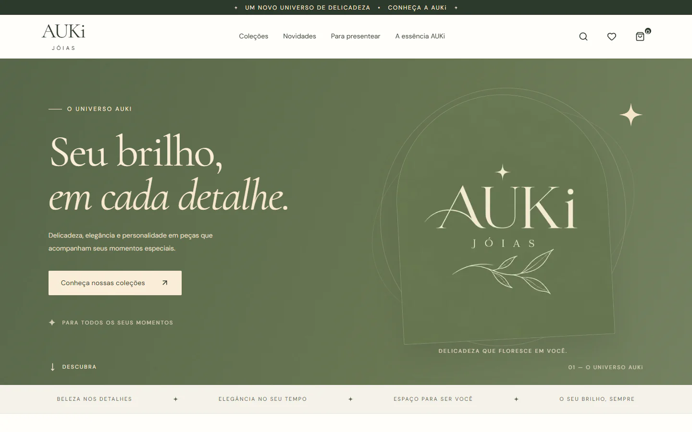

# AUKi Jóias — Jewelry Catalog & Order Requests

A jewelry business needs an organized catalog and a way for customers to express interest without processing an online payment. AUKi connects browsing, saved favorites and a shopping bag to an order-request form and owner follow-up.

**Documentation-only engineering case study. Source code remains proprietary.**

## What was developed

- Search, category filters, bounded catalog pagination, product details and image enlargement.
- Favorites and shopping bag quantities/totals; prices are represented in integer cents and checked on the server.
- Product creation/editing/archiving, photo management, categories, editorial content and private previews.
- Order request: bag → contact information → review → request → owner follow-up. No online charges; legacy payment/shipping endpoints are disabled.
- Request persistence and notification state are separate. Email delivery has disabled, simulated and configured-provider modes.
- Responsive Portuguese interface. Full English localization was not found and is not advertised.

## Technology and technical decisions

Next.js 16.4.2, React 19.3, TypeScript 6, Tailwind CSS, Drizzle ORM, local PGlite, a prepared PostgreSQL adapter, Better Auth with TOTP, Zod, Sharp, Vitest and Playwright.

Integer-cent arithmetic avoids floating-point pricing errors. Server-side totals prevent trusting browser prices. Bounded pagination limits catalog work. Separating persistence from email prevents a transport failure from silently losing a request.

## Validation

Recorded local verification from **October 29, 2026** (earlier runs, reviewed for this package):

| Check | Result |
|---|---|
| Vitest | 151 tests in 7 files passed |
| ESLint | PASS |
| TypeScript | PASS |
| Declared production build (Next.js / Turbopack) | PASS in an isolated local copy |
| npm dependency audit | 0 reported vulnerabilities |

October 27 request-flow report: 186 passing tests (151 unit/integration, 24 browser regression, 5 delivery, 6 request-flow checks). Lighthouse homepage medians across three local runs per profile: performance 95 mobile / 100 desktop; accessibility 100/100; best practices 100/100; SEO 66/66 with intentional noindex. These browser and Lighthouse results were inspected, not rerun today.

## Interface

Owner-approved historical local storefront captures. They show the desktop/mobile presentation and do not demonstrate the newer request form or a live store.

## Development role

Portfolio owner and developer: **Studio Dev (@Studiodev00)**, as identified by the owner of this project. This case study presents implementation and verification evidence. It does not attribute every module exclusively to one person or establish employment, team size or business results from commit history.

## Current boundaries

The declared production build now passes after a minimal route-signature correction. Real notification delivery, hosting and a PostgreSQL deployment were not exercised. The current storefront is Portuguese, not fully bilingual. Previously recorded browser and Lighthouse results remain historical.

## Source and demonstration availability

This repository contains selected documentation and images only. It is not a buildable source distribution and grants no license to the private application. No binaries, production data or credentials are included. Screenshots appear in the Interface section; a supervised demonstration can be discussed with the project owner. No public application demo has been confirmed for this snapshot.

[Architecture](docs/ARCHITECTURE.md) · [Verified features](docs/FEATURES.md) · [Testing](docs/TESTING.md) · [Security](docs/SECURITY.md) · [Publication review](PUBLICATION_REVIEW.md)

No project source code may be uploaded to GitHub, publicly or privately. Only explicitly approved documentation and authorized images are eligible for publication.
